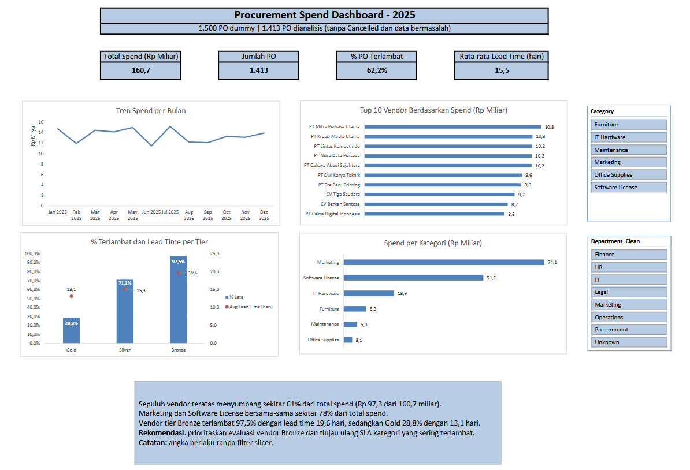

# Procurement Spend Analysis Dashboard (Excel)

Dashboard analisis pengeluaran pengadaan dari 1.500 PO dummy: mulai dari data kotor, proses cleaning, sampai dashboard interaktif dengan PivotTable, PivotChart, dan Slicer.

> Seluruh data bersifat **sintetis** (dibuat dengan Python), bukan data perusahaan asli.



## Pertanyaan bisnis

- Berapa total spend per bulan, kategori, dan departemen?
- Vendor mana yang menyumbang spend terbesar?
- Vendor dan tier mana yang paling sering terlambat mengirim?

## Dataset

| Item | Keterangan |
|---|---|
| Periode | Januari - Desember 2025 |
| Jumlah PO | 1.500 (setelah 25 duplikat dihapus) |
| Vendor | 20 vendor, 3 tier (Gold, Silver, Bronze) |
| Kategori | 6 kategori, masing-masing punya SLA pengiriman (hari kerja) |
| Departemen | 7 departemen |
| Sumber | `generate_procurement_data.py` (pandas), dengan masalah data yang sengaja disisipkan |

## Alur kerja

1. **Generate data** dummy yang kotor dengan Python.
2. **Cleaning** di sheet `Clean_Data`. Sheet `Raw_Data` dibiarkan utuh sebagai data asli.
3. **Enrichment** lewat lookup ke `Vendor_Ref` (nama baku dan tier) dan `Category_Ref` (SLA).
4. **Analisis** dengan 7 PivotTable di sheet `Analysis`.
5. **Dashboard** berisi 4 KPI card, 4 PivotChart, dan 2 Slicer (Category dan Department).

## Log cleaning

| Masalah | Jumlah | Penanganan |
|---|---|---|
| Baris duplikat | 25 | Dihapus dengan Remove Duplicates |
| Nama vendor tidak konsisten (huruf besar/kecil, spasi, "PT." vs "PT") | sekitar 150 | Dibakukan lewat lookup ke `Vendor_Ref` |
| `PO_Date` tersimpan sebagai teks `dd/mm/yyyy` | 40 | Dikonversi dengan `DATE`, `LEFT`, `MID`, `RIGHT` |
| Qty nol atau negatif (`Invalid Qty`) | 5 | Diberi flag, dikeluarkan dari analisis |
| Harga satuan kosong (`Missing Price`) | 6 | Diberi flag, dikeluarkan dari analisis |
| Tanggal terima lebih awal dari tanggal PO (`Delivery Before PO`) | 8 | Diberi flag, dikeluarkan dari analisis |
| Department kosong | 15 | Diisi `Unknown`, tetap dianalisis |

Hasil akhir: dari 1.500 baris, **1.481 baris berstatus `OK`** dan 19 baris di-flag (5 + 6 + 8). PO berstatus Cancelled juga dikeluarkan dari perhitungan spend, sehingga **1.413 PO** masuk ke dashboard.

Kolom `Issue_Flag` hanya menampilkan satu masalah per baris, dengan urutan pemeriksaan: Qty, harga, lalu tanggal.

## Definisi metrik

| Metrik | Definisi |
|---|---|
| Total Spend | `Qty x Unit_Price`, hanya baris `Issue_Flag = OK` dan status bukan Cancelled |
| Lead Time | Hari kerja dari tanggal PO sampai tanggal terima (`NETWORKDAYS`, tanpa libur nasional), hanya untuk PO berstatus Delivered |
| Terlambat | Lead time melebihi SLA kategori **lebih dari 2 hari kerja** (toleransi 2 hari) |
| % Terlambat | Rata-rata kolom `Is_Late` (1 = terlambat, 0 = tepat waktu) |

## Insight utama

- Total spend yang dianalisis **Rp 160,7 miliar** dari 1.413 PO.
- **10 vendor teratas** menyumbang sekitar **61%** dari total spend (Rp 97,3 dari 160,7 miliar).
- **Marketing dan Software License** bersama-sama menyumbang sekitar **78%** dari total spend.
- Secara keseluruhan **62,2%** PO terlambat, dengan rata-rata lead time **15,5 hari kerja**.
- Keterlambatan sangat berbeda antar tier vendor:

| Tier | % Terlambat | Rata-rata lead time |
|---|---|---|
| Gold | 28,8% | 13,1 hari |
| Silver | 71,1% | 15,3 hari |
| Bronze | 97,5% | 19,6 hari |

**Rekomendasi:** prioritaskan evaluasi vendor tier Bronze, dan tinjau ulang SLA pada kategori yang vendornya paling sering terlambat.

## Fitur Excel yang dipakai

- **Struktur data:** Excel Table, Remove Duplicates, Conditional Formatting
- **Cleaning:** `TRIM`, `SUBSTITUTE`, `IF`, `IFERROR`, `ISNUMBER`, `DATE`, `LEFT`, `MID`, `RIGHT`
- **Lookup dan hitungan:** `INDEX/MATCH`, `NETWORKDAYS`, `COUNTIF`, `SUMIFS`
- **Analisis:** PivotTable, PivotChart, Slicer, `GETPIVOTDATA` (KPI card yang ikut berubah saat slicer dipakai)

## Struktur repo

```
procurement-excel-dashboard/
 ├ procurement_dashboard.xlsx      file utama
 ├ procurement_raw.xlsx            data mentah hasil script
 ├ generate_procurement_data.py    script pembuat data dummy
 ├ screenshots/
 │   └ dashboard.png
 └ README.md
```

Sheet di dalam `procurement_dashboard.xlsx`: `Dashboard`, `Analysis`, `Clean_Data`, `Vendor_Ref`, `Category_Ref`, `Raw_Data`.

## Cara menjalankan ulang

Membuat ulang data mentah:

```
pip install pandas openpyxl
python generate_procurement_data.py
```

Script menghasilkan `procurement_raw.xlsx` dengan seed tetap, sehingga hasilnya selalu sama. Tutup file Excel tersebut sebelum menjalankan script, karena file yang terbuka akan menyebabkan `PermissionError`.

Setelah data di `Clean_Data` berubah, jalankan **Data > Refresh All** supaya semua pivot dan chart diperbarui.

## Keterbatasan

- Data sintetis, sehingga pola keterlambatan antar vendor dibuat sengaja dan tidak mencerminkan kondisi nyata.
- Hari kerja tidak memperhitungkan libur nasional.
- Angka di kotak insight pada dashboard berlaku tanpa filter Slicer.
- PivotTable tidak otomatis ter-refresh saat data berubah.

## Rencana pengembangan

- Menjawab pertanyaan bisnis yang sama dengan **SQL** (GROUP BY dan window function), lalu mencocokkan hasilnya dengan pivot di Excel.
- Mengotomatiskan cleaning dengan Power Query atau Python.
